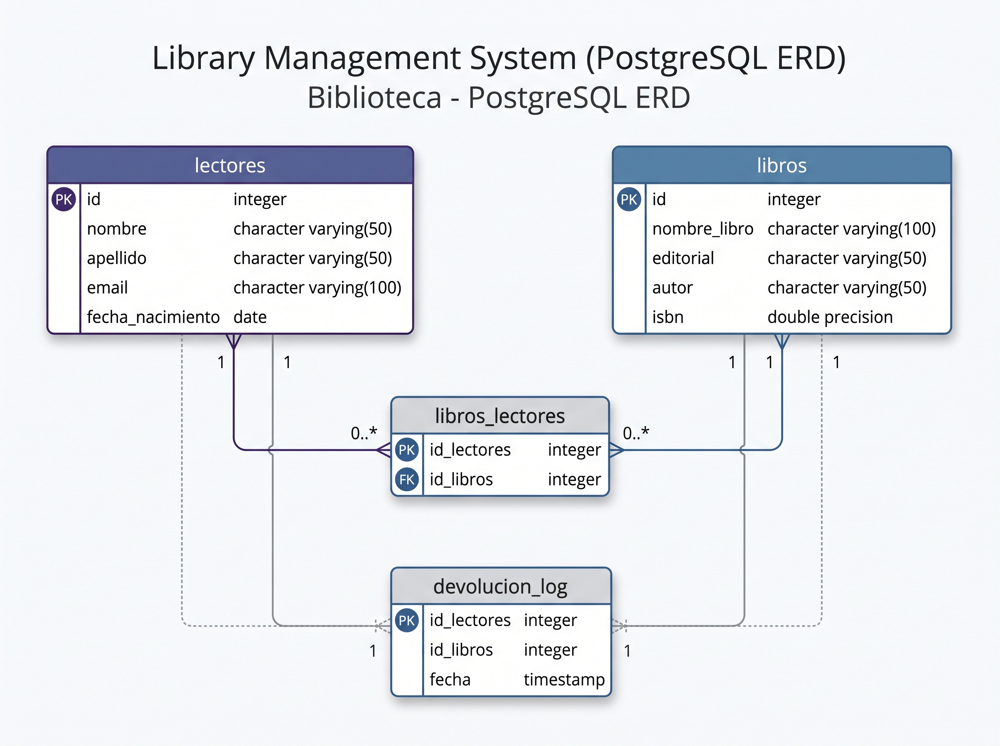

# 📐 Documentación Técnica y Modelo de Datos

En esta carpeta se encuentra la documentación gráfica y conceptual correspondiente a la arquitectura de la base de datos del **Sistema de Gestión de Biblioteca**.

---

## 🗺️ Diagrama Entidad-Relación (DER)

El siguiente diagrama ilustra la estructura de las tablas, sus claves primarias, claves foráneas y los tipos de relaciones entre las entidades del sistema:

---

## 🗂️ Explicación del Modelo

### 1. `lectores`
Representa a los usuarios registrados en la biblioteca.
* **`id`**: Clave primaria (`PK`), autoincremental (`SERIAL`).
* **`nombre` / `apellido`**: Datos de identificación del lector.
* **`email`**: Campo con restricción `UNIQUE` para evitar registros duplicados.
* **`fecha_nacimiento`**: Utilizado para calcular rangos de edad y estadísticas.

### 2. `libros`
Catálogo de ejemplares disponibles en la biblioteca.
* **`id`**: Clave primaria (`PK`), autoincremental (`SERIAL`).
* **`nombre_libro`**: Título de la obra.
* **`editorial` / `autor`**: Datos bibliográficos de la publicación.
* **`isbn`**: Identificador único del libro (`BIGINT UNIQUE`).

### 3. `libros_lectores` *(Tabla Asociativa / Relación M:N)*
Gestiona los préstamos activos entre lectores y libros.
* **`id_lectores`**: Clave foránea (`FK`) vinculada a `lectores(id)`.
* **`id_libros`**: Clave foránea (`FK`) vinculada a `libros(id)`.
* **Clave Primaria Compuesta (`PK`)**: La combinación (`id_lectores`, `id_libros`) garantiza que un lector no registre préstamos duplicados del mismo ejemplar simultáneamente.

### 4. `devolucion_log` *(Tabla de Auditoría)*
Registra automáticamente el historial de devoluciones procesadas.
* Se nutre de manera transparente mediante el trigger `trigger_delete` configurado para ejecutarse `BEFORE DELETE` sobre la tabla `libros_lectores`.
* Almacena las referencias (`id_lectores`, `id_libros`) junto con la fecha y hora exactas (`TIMESTAMP`) en que finalizó el préstamo.
